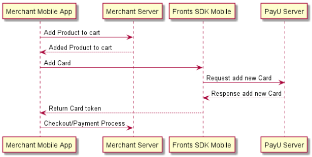
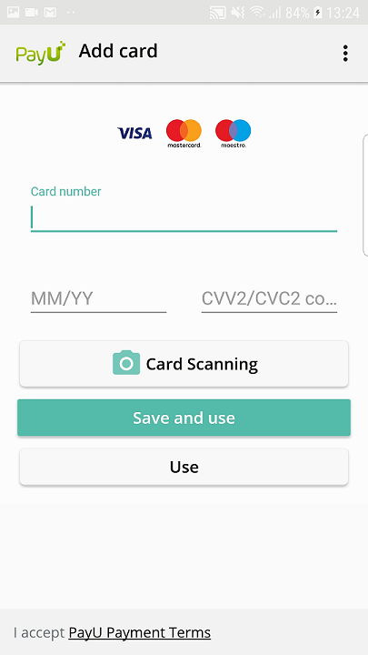
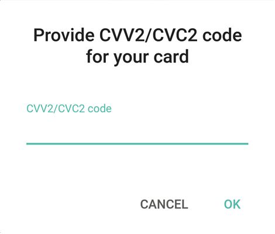

# payment-add-card-module

This module is part of [PayU Mobile SDK for Android](../README.md). For the requirements, installation and the server side of the integration, see the [main README](../README.md).

`payment-add-card-module` lets the payer enter card details and tokenizes the card in PayU. It also handles the `WARNING_CONTINUE_CVV` status after you create the order. If you use `payment-library-chooser-module`, this module is already included.

Before you start, make sure card tokenization is enabled on your POS. To display the payer's saved cards, your server also needs `grant_type=trusted_merchant`.



1. **Add Product to cart** – the payer adds a product to the cart.
2. **Add Card** – the payer selects "add card" on the checkout screen.
3. **Add Card** – your app opens the view with the add card module.
4. **Request add new Card** – the SDK sends the card to PayU for tokenization.
5. **Return Card token** – the SDK returns the card token to your app.
6. **Checkout/Payment Process** – the payer finishes the checkout in your app.
7. **Checkout/Payment Process** – your server creates the order.



The module provides the input fields. You provide the buttons and their labels. The module sends the tokenization request and returns a card token of the [type](#tokenizing-the-card) you select.

## Card Form

To use the card form, add `NewCardView` to your layout:

```xml
<com.payu.android.front.sdk.payment_add_card_module.view.NewCardView
    android:id="@+id/new_card_view"
    android:layout_width="match_parent"
    android:layout_height="wrap_content" />
```

The view contains the card number, expiration date and CVV fields, and the PayU footer.

## Tokenizing the Card

Create a `CardServiceTokenizer` instance with `NewCardService.newInstance()`:

```java
/**
 * @param view     NewCardView for adding a new card
 * @param context
 * @param callback NewCardCallback, invoked when the card has been added in PayU
 */
public static CardServiceTokenizer newInstance(@NonNull NewCardView view,
                                               @NonNull Context context,
                                               @NonNull NewCardCallback callback);
```

Add a button that calls `CardServiceTokenizer#addCard(String posId, TokenType type)`. The method validates the card data and, if it is valid, sends it for tokenization. Possible token types:

- `SINGLE` – the card is not saved. The token is valid for 11 minutes.
- `SINGLE_LONGTERM` – the card is not saved.
- `MULTI` – the card is saved. After the first payment, the card appears in the payer's [payment methods](https://developers.payu.com/europe/docs/checkout/payment-methods-retrieve/).

Provide a callback when you create the instance:

```java
public interface NewCardCallback {
    /**
     * Returns the card token.
     *
     * @param cardPaymentMethod payment method to use in the payment process
     */
    void onSuccess(CardPaymentMethod cardPaymentMethod);

    /**
     * Returns an error from the network or from PayU.
     *
     * @param error information about the tokenization problem
     */
    void onError(Error error);
}
```

- `onSuccess` – returns `CardPaymentMethod`. Pass the token from `CardPaymentMethod.getValue()` to your server, which includes it in the `payMethod` object of the [order](https://developers.payu.com/europe/docs/payment-solutions/cards/tokenization/charge-token/).
- `onError` – returns the error. To check its type, call `Error.getErrorLiteral()`.

The order response for a card payment is usually `SUCCESS`, `WARNING_CONTINUE_3DS` or `WARNING_CONTINUE_CVV`. For all status codes, see [Status Codes](https://developers.payu.com/europe/docs/payment-flows/auth-and-order/#status-codes) in the PayU Developer Guide.

## Dynamic Card Options

To set the card options in code instead of in `payu.xml`, add the key with the name of your configuration class:

```xml
<string name="payu_payment_dynamic_card_configuration_qualified_name">com.payu.android.front.sdk.demo.config.DynamicCardPayment</string>
```

The class must implement the `DynamicCardActions` interface:

```java
public class DynamicCardPayment implements DynamicCardActions {

    private boolean addCard = true;
    private boolean saveAndUse = false;
    private boolean scanCardOption = false;

    public DynamicCardPayment(Context context) {
    }

    @Override
    public boolean addCardFlow() {
        return addCard;
    }

    @Override
    public boolean saveAndUseOption() {
        return saveAndUse;
    }

    @Override
    public boolean scanCardOption() {
        return scanCardOption;
    }
}
```

With this key set, the static card options in `payu.xml` (adding, saving and scanning cards) are ignored.

## Handling CVV

The `WARNING_CONTINUE_CVV` status in the order response means that the payer must enter the CVV code. If the payer does not enter it, the payment is canceled.

```json
{
    "status": {
        "statusCode": "WARNING_CONTINUE_CVV"
    },
    "redirectUri": "{redirect_url}",
    "orderId": "WZHF5FFDRJ140731GUEST000P01",
    "extOrderId": "{your_order_id}"
}
```

To ask the payer for the CVV code, call `CvvValidationService.validateCvv()` with the `redirectUri` from the order response:

```java
CvvValidationService.validateCvv(activity,
    new AuthorizationDetails.Builder()
        .withLink("redirectUri from the order response")
        .build(),
    new CvvValidationListener() {
        @Override
        public void onValidationCompleted(@NonNull CvvPaymentStatus cvvPaymentStatus) {
            // Handle the payment status.
        }
    }
);
```

Possible statuses (`CvvPaymentStatus`):

- `SUCCESS` – the CVV code was accepted. Wait for the final payment status in the [notification](https://developers.payu.com/europe/docs/payment-flows/lifecycle/#notifications) sent to your server.
- `PAYMENT_ERROR` – the transaction failed (for example, a timeout).
- `CANCEL_PAYMENT` – the payer canceled the transaction.


