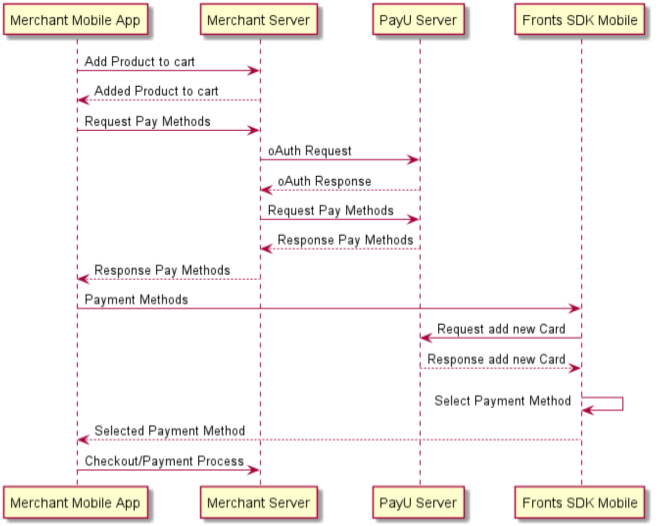
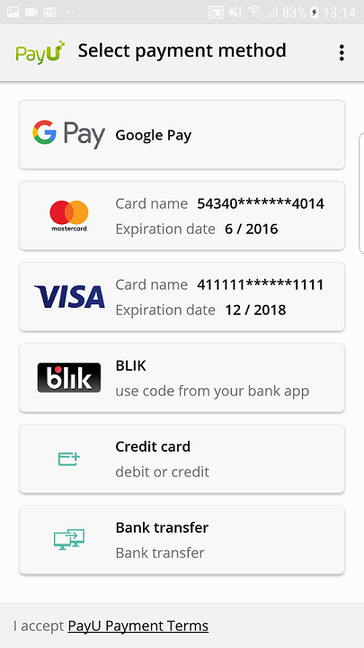
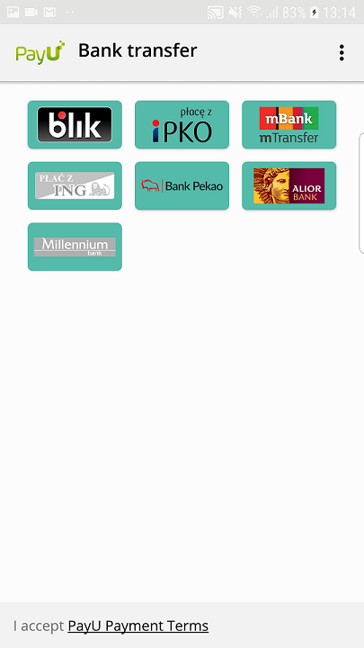

# payment-library-chooser-module

This module is part of [PayU Mobile SDK for Android](../README.md). For the requirements, installation and the server side of the integration, see the [main README](../README.md).

`payment-library-chooser-module` displays the payment methods available to the payer and returns the method the payer selects. It includes `payment-add-card-module`, so the payer can also add a new card. To let the payer scan the card with the camera, add [`payment-library-card-scanner`](../payment-library-card-scanner/README.md).

Before you start, make sure your server can [retrieve payment methods](https://developers.payu.com/europe/docs/checkout/payment-methods-retrieve/) from PayU.



1. **Add Product to cart** – the payer adds a product to the cart.
2. **Request Pay Methods** – the app requests the payment methods from your server.
3. **OAuth Request** – your server requests an OAuth token from PayU.
4. **OAuth Response** – PayU returns the token.
5. **Request Pay Methods** – your server requests the payment methods from PayU.
6. **Response Pay Methods** – PayU returns the payment methods.
7. **Payment Method** – the SDK displays the payment methods in your app.
8. **Request add new Card** – the SDK sends the new card to PayU for tokenization.
9. **Response add new Card** – PayU returns the card token.
10. **Select Payment Method** – the payer selects a payment method in the SDK.
11. **Selected Payment Method** – the SDK returns the selected method to your app.
12. **Checkout/Payment Process** – your server creates the order.

## Screens

**Payment method selector without a selected method**


**Payment method selection screen**



The payment method selection screen is the main view of the SDK. It shows the PayU icon (or your icon), a footer with information about PayU as the payment processor, and the list of payment methods. The last selected method is always first, followed by Google Pay, BLIK and saved cards. At the bottom, there are two buttons: **Add Card** (opens the add card form) and **Bank Transfer** (opens the pay-by-link methods).

**Pay-by-link chooser screen**



Disabled payment methods are grayed out. The payment methods in your app may differ from the screenshots.

## Providing the POS ID

Provide the POS ID by overriding the `PaymentMethodActions#providePosId` method. Call the listener as soon as the POS ID is available. Do not call `super.providePosId()` – it throws `NotImplementedException`.

```java
public class PaymentMethodsActionsImpl extends PaymentMethodActions {
    // ...
    @Override
    public void providePosId(@NonNull PosIdListener posIdListener) {
        // The POS must match the environment set in payu.xml (production or sandbox).
        posIdListener.onPosId("YOUR_POS_ID");
    }
}
```

## Passing Payment Methods

The SDK displays the payment methods that your server retrieved from PayU. To pass them to the SDK, extend the `PaymentMethodActions` class and set its name in the `payu_payment_methods_fully_qualified_name` key. The class has two main methods:

- `providePaymentMethods(PaymentMethodsCallback callback)` – the SDK calls it whenever it needs payment methods. Retrieve them from your server and call `callback.onFetched(List<PaymentMethod> paymentMethods)`. Pass the PayU response as-is, without filtering it.
- `onPaymentMethodRemoved(PaymentMethod paymentMethod)` – the SDK calls it when the payer removes a payment method. See [Removing a Payment Method](#removing-a-payment-method).

Create the payment methods with the builders of the `PaymentMethodCreator` class: `pblBuilder()` for pay-by-link methods and `cardBuilder()` for cards.

```java
public class DemoMethodsActions extends PaymentMethodActions {

    private final List<PaymentMethod> paymentMethods;

    public DemoMethodsActions(Context context) {
        super(context);
        paymentMethods = Arrays.asList(
            PaymentMethodCreator.pblBuilder()
                .withName("Name")
                .withValue("B")
                .withBrandImageUrl("https://static.payu.com/images/mobile/logos/pbl_blik.png")
                .withStatus("ENABLED")
                .build(),

            PaymentMethodCreator.cardBuilder()
                .withBrandImageUrl("https://static.payu.com/images/mobile/visa.png")
                .withCardExpirationMonth("12")
                .withCardExpirationYear("2029")
                .withCardNumberMasked("411111******1111")
                .withCardScheme("VS")
                .withValue("VALUE")
                .withPreferred(false)
                .withStatus("ACTIVE")
                .build());
    }

    @Override
    public void providePaymentMethods(final PaymentMethodsCallback callback) {
        // Retrieve the payment methods from your server.
        new Handler().postDelayed(() -> callback.onFetched(paymentMethods), 20);
    }

    @Override
    public void onPaymentMethodRemoved(PaymentMethod paymentMethod) {
        // Ask your server to delete the card token.
    }
}
```

## Removing a Payment Method

The payer can remove a payment method by long-pressing it or swiping it. The SDK then calls `onPaymentMethodRemoved(PaymentMethod paymentMethod)`. The method is called only for cards (`CardPaymentMethod`) – delete the card token on your server with the [delete token](https://developers.payu.com/europe/docs/payment-solutions/cards/tokenization/retrieve-and-delete-token/#token-delete) request. Other payment methods are removed only locally (if possible) and are restored when the app restarts.

## Getting the Selected Method

To get the selected payment method, call `getPaymentMethod()` on `PaymentChooserWidget`. To check whether any method is selected, call `isPaymentMethodSelected()`.

## BLIK Payments

To display BLIK, set the `payu_blik_payment` key to `true` in `payu.xml` (the default is `false`):

```xml
<bool name="payu_blik_payment">true</bool>
```

With this key set to `true`, the SDK does not filter out BLIK payment methods. BLIK is displayed on the payment method selection screen (`PaymentMethodActivity`).

If the retrieved payment methods do not include any BLIK token, the SDK adds a generic BLIK item above the cards. After selecting it, the payer enters the 6-digit code from the bank app. If the retrieved payment methods include a BLIK token, the payer does not have to enter the code.

```java
// Builder for a BLIK payment method
PaymentMethodCreator.blikPaymentBuilder();
```

To handle the BLIK method selected by the payer, check the payment type:

```java
PaymentMethod paymentMethod = paymentChooserWidget.getPaymentMethod().getValue();
if (paymentMethod != null) {
    switch (paymentMethod.getPaymentType()) {
        case BLIK_GENERIC:
            if (paymentChooserWidget.isBlikAuthorizationCodeProvided()) {
                Log.v(TAG_BLIK_PAYMENT, "Generic BLIK payment: " + paymentChooserWidget.getBlikAuthorizationCode());
            } else {
                Toast.makeText(this, "BLIK code is not provided", Toast.LENGTH_SHORT).show();
            }
            break;
        case BLIK_TOKENS:
            if (paymentChooserWidget.isBlikAuthorizationCodeNeeded()) {
                if (paymentChooserWidget.isBlikAuthorizationCodeProvided()) {
                    Log.v(TAG_BLIK_PAYMENT, "Saved BLIK payment with code: " + paymentChooserWidget.getBlikAuthorizationCode());
                } else {
                    Toast.makeText(this, "BLIK code is not provided", Toast.LENGTH_SHORT).show();
                }
            } else {
                Log.v(TAG_BLIK_PAYMENT, "Saved BLIK payment with token (without code): " + paymentMethod.getValue());
            }
            break;
    }
}
```

- `BLIK_GENERIC` – the payer has no saved BLIK token, so the payer must enter the 6-digit code.
- `BLIK_TOKENS` – the payer has a saved BLIK token (returned in the retrieved payment methods). The payer can pay with the token or enter a new code.

`PaymentChooserWidget` provides the following methods for BLIK:

- `boolean isBlikAuthorizationCodeNeeded()` – whether the payer must enter the BLIK code.
- `String getBlikAuthorizationCode()` – the code entered by the payer, or `null`.
- `boolean isBlikAuthorizationCodeProvided()` – whether the payer entered the full 6-digit code.

Pass the BLIK code or token to your server, which includes it in the [order](https://developers.payu.com/europe/docs/payment-solutions/blik/integration/).

### Selecting a Bank App for a BLIK Token

If the payer has more than one bank app linked to the BLIK token, the order response contains the `AUTH_TOKEN_NONUNIQUE` status with the list of bank apps. To let the payer select one:

1. Implement `provideBlikPaymentMethods()` from the `PaymentMethodActions` class and pass it the bank apps from the order response:

   ```java
   @Override
   public void provideBlikPaymentMethods(final @NonNull PaymentMethodsCallback callback) {
       callback.onFetched(bliks);
   }
   ```

   Create each bank app with the builder:

   ```java
   PaymentMethodCreator.blikAmbiguityPaymentMethodBuilder()
       .withKey("testKey")
       .withLabel("testLabel")
       .build();
   ```

2. Display the list of bank apps in a new activity:

   ```java
   BlikAmbiguityService.selectAmbiguityBlik(context);
   ```

3. Get the selected bank app in `onActivityResult`:

   ```java
   @Override
   protected void onActivityResult(int requestCode, int resultCode, Intent data) {
       if (requestCode == BlikAmbiguityService.REQUEST_CODE) {
           PaymentMethod paymentMethod = BlikAmbiguityService.extractSelectedBlikResult(data);
       }
   }
   ```

4. Pass the value of the selected payment method (`getValue()`, the key set with `withKey()`) to your server, which creates the order again with this value in the `blikData.appKey` field.

## Widget

To place the payment method widget in your layout, add `PaymentChooserWidget`. The widget changes its state depending on whether the payer has selected a payment method.

```xml
<com.payu.android.front.sdk.payment_library_payment_chooser.payment_method.external.widget.PaymentChooserWidget
    android:id="@+id/selected_payment_textView"
    android:layout_width="match_parent"
    android:layout_height="wrap_content"
    android:layout_gravity="center"
    android:background="@color/background_payu_widget"
    android:padding="@dimen/padding_large" />
```

To clear the selected payment method and remove all fetched methods from the widget, call `cleanPaymentMethods()` on `PaymentChooserWidget`.
