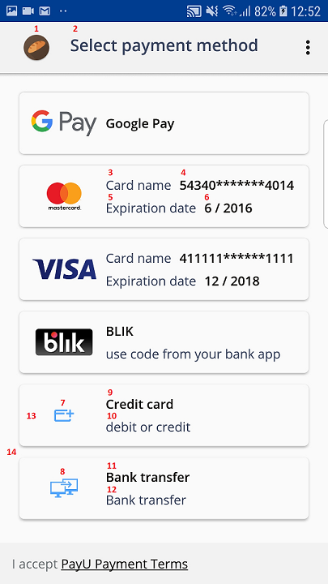
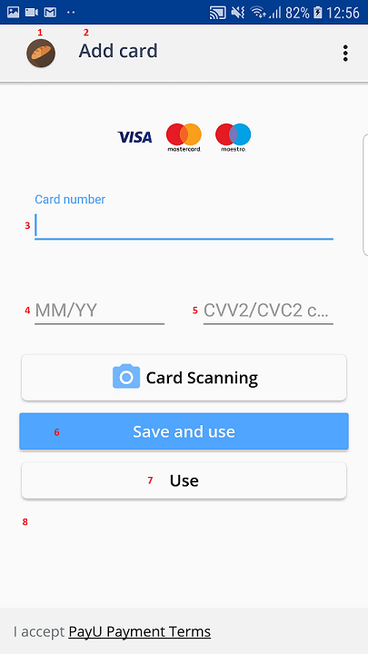
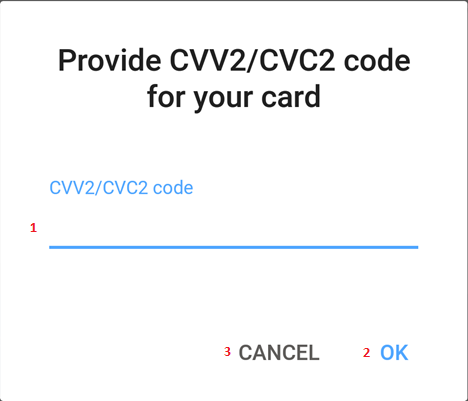
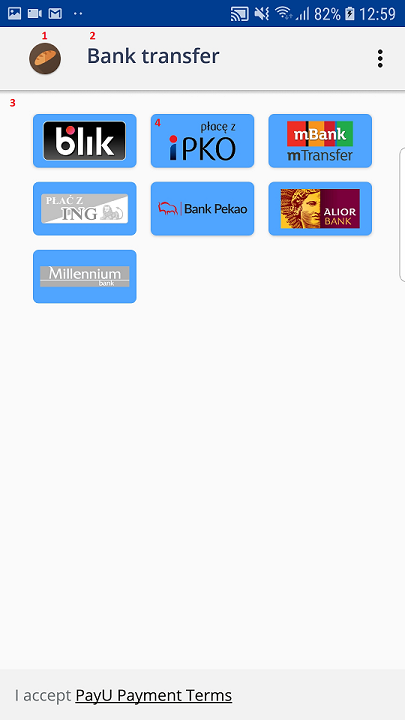

# payment-library-core-android

This module is part of [PayU Mobile SDK for Android](../README.md). For the requirements, installation and the server side of the integration, see the [main README](../README.md).

`payment-library-core-android` contains the configuration and the visual customization shared by all modules.

## Configuration

All modules read their configuration from the `res/values/payu.xml` file. Create the file, or add the keys to it if it already exists.

```xml
<?xml version="1.0" encoding="utf-8"?>
<resources xmlns:tools="http://schemas.android.com/tools" tools:ignore="TypographyDashes">
    <string name="payu_environment">sandbox</string>
    <string name="payu_language">auto</string>
    <string name="payu_payment_methods_fully_qualified_name">com.example.shop.PaymentMethodsProvider</string>
    <bool name="payu_add_card_option">true</bool>
    <bool name="payu_save_and_use_card">true</bool>
    <bool name="payu_pbl_option">true</bool>
    <bool name="payu_card_scanner">true</bool>
    <bool name="payu_blik_payment">true</bool>
</resources>
```

| Key | Type | Description |
|---|---|---|
| `payu_environment` | string | Environment used by the SDK. Possible values are `production` and `sandbox`. The POS must belong to the same environment. |
| `payu_language` | string | Supported values are: `auto` (default: English, will try to use translations: Polish, English, German, Hungarian, Czech or Slovak), `polish`, `english`, `german`, `hungarian`, `czech` or `slovak`. With `auto`, the SDK uses the device language if possible, and English otherwise. |
| `payu_payment_methods_fully_qualified_name` | string | Fully qualified name (with the package) of the class that provides payment methods to the SDK. See [Passing Payment Methods](../payment-library-chooser-module/README.md#passing-payment-methods). |
| `payu_style_class_fully_qualified_name` | string | Fully qualified name (with the package) of the class that defines your custom styles. See [Visual Customization](#visual-customization). |
| `payu_payment_dynamic_card_configuration_qualified_name` | string | Optional. Fully qualified name of the class that provides dynamic card options. If set, `payu_save_and_use_card`, `payu_add_card_option` and `payu_card_scanner` are ignored. See [Dynamic Card Options](../payment-add-card-module/README.md#dynamic-card-options). |
| `payu_add_card_option` | boolean | Shows or hides the button for adding a new card on the payment method selection screen. Without it, the payer cannot add a new card. Default: `true`. If set to `true`, you must provide your POS ID, and the POS must be configured for card tokenization. |
| `payu_save_and_use_card` | boolean | Shows or hides the "Save and use" button in the add card view. Default: `true`. |
| `payu_pbl_option` | boolean | Shows or hides pay-by-link payment methods on the payment method selection screen. Default: `true`. |
| `payu_card_scanner` | boolean | Enables the [card scanner](../payment-library-card-scanner/README.md). Default: `false`. |
| `payu_card_scanner_scan_date` | boolean | Specifies whether the card scanner also reads the card expiration date. Default: `true`. |
| `payu_blik_payment` | boolean | Shows or hides the BLIK payment method on the payment method selection screen. Default: `false`. |

## Visual Customization

You can adjust the SDK screens to your brand: colors, fonts, paddings and icons.

### Style Class

Create a class that extends `BaseStyleConfiguration` and set its name in `payu.xml`. Without it, the SDK uses the default style.

```xml
<string name="payu_style_class_fully_qualified_name">com.example.shop.MerchantStyle</string>
```

The class can override four methods:

| Method | Description |
|---|---|
| `pathIconPBLPayment()` | Drawable resource ID of the icon displayed on the pay-by-link button in `payment-library-chooser-module`. |
| `pathIconAddNewCard()` | Drawable resource ID of the icon displayed on the add card button in `payment-library-chooser-module`. |
| `payuLibraryIcon()` | Drawable used as the library icon in the toolbar of all modules. |
| `payuStyle()` | Resource ID of your style. It must extend `@style/Theme.PayU.Fronts`. |

Extend your style from `Theme.PayU.Fronts` in `styles.xml`:

```xml
<style name="MerchantStyle" parent="Theme.PayU.Fronts">
    <item name="payu_styles_toolbarColor">@color/background_toolbar</item>
    <item name="payu_styles_backgroundColor">@color/background_main</item>
    <item name="payu_styles_separatorColor">@color/background_item</item>
    <item name="payu_styles_primaryColor">@color/colorPrimary</item>
    <item name="payu_styles_accentColor">@color/colorAccent</item>
    <item name="payu_styles_windowContentPadding">15dp</item>
</style>
```

You can change these properties of the base style:

`payu_styles_backgroundColor`, `payu_styles_toolbarColor`, `payu_styles_separatorColor`, `payu_styles_fontColor`, `payu_styles_primaryColor`, `payu_styles_accentColor`, `payu_styles_windowContentPadding`, `payu_styles_textStyleButtonBasic`, `payu_styles_textStyleButtonPrimary`, `payu_styles_textStyleTitle`, `payu_styles_textStyleHeader`, `payu_styles_textStyleHeadline`, `payu_styles_textStyleDescription`, `payu_styles_textStyleText`, `payu_styles_textStyleInput`.

### Widget Styles

You can configure eight widget styles in three groups: text (title, header, headline, description, text), buttons (buttonBasic, buttonPrimary) and input text (input).

**Text styles** extend `Style.PayU.Fronts.Text` and have these properties from `Theme.PayU.Fronts`: `payu_styles_textColor`, `payu_styles_textSize`, `payu_styles_font`, `payu_styles_paddingBottom`, `payu_styles_paddingTop`, `payu_styles_paddingLeft`, `payu_styles_paddingRight`.

| Style | Parent style | Reference in |
|---|---|---|
| Title | `TextAppearance.PayU.PrimaryHeaderText` | `payu_styles_textStyleTitle` |
| Header | `TextAppearance.PayU.SecondaryHeaderText` | `payu_styles_textStyleHeader` |
| Headline | `Style.PayU.Fronts.HeadlineText` | `payu_styles_textStyleHeadline` |
| Description | `Style.PayU.Fronts.DescriptionText` | `payu_styles_textStyleDescription` |
| Text | `Style.PayU.Fronts.NormalText` | `payu_styles_textStyleText` |

**Button styles:** buttonBasic extends `Style.PayU.Fronts.Text` and adds `payu_styles_buttonBackgroundColor`. To configure it, extend `TextAppearance.PayU.Button` and reference it in `payu_styles_textStyleButtonBasic`. buttonPrimary extends buttonBasic – extend `TextAppearance.PayU.Button.Primary` and reference it in `payu_styles_textStyleButtonPrimary`.

**Input text:** `TextAppearance.PayU.EditText`, which extends `Style.PayU.Fronts.Text`.

### Screens

**Payment method widget with a selected method**


- **1** – name of the selected payment method: `payu_styles_textStyleHeader`.
- **2** – secondary information, for example the card number: `payu_styles_textStyleDescription`.
- **3** – background: `payu_styles_accentColor`.

**Payment method selection screen (with Google Pay)**



- **1** – toolbar icon (can be changed).
- **2** – toolbar text: `payu_styles_textStyleTitle`.
- **3, 5, 10, 12** – `payu_styles_textStyleDescription`.
- **4, 6, 9, 11** – `payu_styles_textStyleHeadline`.
- **7** – card icon (can be changed).
- **8** – bank icon (can be changed).
- **13** – the add card button (can be turned off with `payu_add_card_option`).
- **14** – background: `payu_styles_backgroundColor` (default `#FCFCFC`).

The items use `payu_styles_textStyleButtonBasic`.

**Add card screen**



- **1** – toolbar icon (can be changed).
- **2** – toolbar text: `payu_styles_textStyleTitle`.
- **3, 4, 5** – `payu_styles_textStyleInput` (text color and size) with `payu_styles_windowContentPadding`. Android applies its default `TextInputEditText` style for the platform API level.
- **6** – if the "Save and use" button is enabled: `payu_styles_textStyleButtonPrimary`.
- **7** – if the "Save and use" button is enabled: `payu_styles_textStyleButtonBasic`, otherwise `payu_styles_textStyleButtonPrimary`.
- **8** – background: `payu_styles_backgroundColor` with `payu_styles_windowContentPadding`.

**CVV dialog**



- **1** – text color and size: `payu_styles_textStyleInput`.
- **2** – positive button color: `payu_styles_accentColor`.
- **3** – negative button color: the text color with transparency.

**Pay-by-link chooser screen**



- **1** – toolbar icon (can be changed).
- **2** – toolbar text: `payu_styles_textStyleTitle`.
- **3** – background: `payu_styles_backgroundColor` with `payu_styles_windowContentPadding`.
- **4** – items: `payu_styles_textStyleButtonBasic`.

### PayU Terms and Conditions Footer

To add the PayU footer with the terms and conditions to your layout:

```xml
<com.payu.android.front.sdk.payment_library_core_android.conditions_view.PayUTermView
    android:layout_width="match_parent"
    android:layout_height="wrap_content" />
```

> [!NOTE]
> The footer cannot be customized with the `Theme.PayU.Fronts` style.
