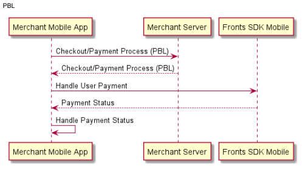
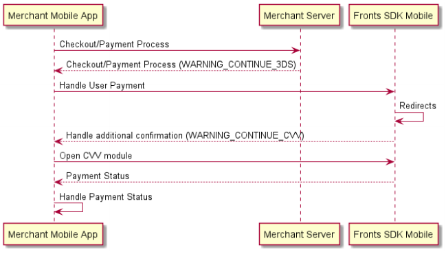
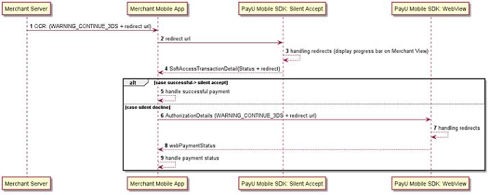

# payment-library-webview-module

This module is part of [PayU Mobile SDK for Android](../README.md). For the requirements, installation and the server side of the integration, see the [main README](../README.md).

`payment-library-webview-module` handles payments that need a browser – pay-by-link, PEX and 3DS – in a WebView, so the payer does not leave your app. A successful result in the WebView does not mean the money has been transferred: PayU sends the final payment status to your server in a notification.



1. **Checkout/Payment Process** – the payer selects pay-by-link.
2. **Checkout/Payment Process** – your app asks your server to create the order in PayU.
3. **Checkout/Payment Process** – your server returns the order response to your app, which passes it to the SDK.
4. **Handle User Payment** – the SDK opens the bank's page and checks whether the payer has paid.
5. **Payment Status** – the SDK returns the status to your app.

The flow for 3DS is the same.

To use the WebView, your server must create an order with the pay-by-link method (or receive `WARNING_CONTINUE_3DS`), and the order response must contain `redirectUri`. Set `continueUrl` in the order – the SDK uses it to recognize the end of the payment:

```json
{
  "continueUrl": "https://your.eshop.com/",
  "notifyUrl": "https://your.eshop.com/notify",
  "customerIp": "127.0.0.1",
  "merchantPosId": "300746",
  "description": "RTV market",
  "currencyCode": "PLN",
  "totalAmount": "1000",
  "buyer": {
    "email": "john.doe@example.com",
    "phone": "654111654",
    "firstName": "John",
    "lastName": "Doe",
    "language": "pl"
  },
  "products": [
    {
      "name": "Wireless Mouse for Laptop",
      "unitPrice": "500",
      "quantity": "2"
    }
  ],
  "payMethods": {
    "payMethod": {
      "type": "PBL",
      "value": "o"
    }
  }
}
```

The SDK determines the result from the last redirect:

- **Success** – the last redirect goes to `continueUrl` without query parameters, or with parameters that do not contain `error` or `failure`.
- **Error or failure** – the last redirect goes to `continueUrl` with the `error` or `failure` query parameter.

During the payment, the payer is redirected to the bank's site. Errors on that site, for example SSL errors caused by wrongly configured or expired certificates, are not caused by PayU.

## Starting the Payment

Create `AuthorizationDetails` with at least the `redirectUri` from the order response and your `continueUrl`:

```java
AuthorizationDetails authorizationDetails = new AuthorizationDetails.Builder()
    .withAuthorizationType(PaymentAuthorization.PAY_BY_LINK) // or PaymentAuthorization._3DS
    .withContinueUrl("https://your.eshop.com/")              // continueUrl from the order
    .withLink("{redirectUri}")                               // redirectUri from the order response
    .build();
```

Supported authorization types for the WebView: `PAY_BY_LINK` (pay-by-link selected as the payment method) and `_3DS` (`WARNING_CONTINUE_3DS` in the order response). Optionally, you can also pass `withOrderId()` and `withExtOrderId()` – the SDK returns them in the result.

Start the payment:

```java
WebPaymentService.pay(activity, authorizationDetails);
```

When the payment ends, the SDK calls `onActivityResult()` of the starting activity. The intent contains a `Parcelable` with the `INTENT_WEB_PAYMENT_EXTRA` key:

```java
@Override
protected void onActivityResult(int requestCode, int resultCode, Intent data) {
    if (requestCode == WebPaymentService.REQUEST_CODE) {
        PaymentDetails paymentDetails = WebPaymentService.extractPaymentResult(data);
    }
}
```

Possible statuses (`WebPaymentStatus`) in `PaymentDetails`:

| Status | Description |
|---|---|
| `SUCCESS` | Successful transaction. |
| `PAYMENT_ERROR` | Transaction failed (for example, a timeout). |
| `SSL_VALIDATION_ERROR` | SSL validation failed for the URL. Contact the owner of the page. |
| `CANCEL_PAYMENT` | The payer canceled the transaction. |
| `WARNING_CONTINUE_CVV` | The payer must confirm the transaction with the CVV code. See [Handling CVV](../payment-add-card-module/README.md#handling-cvv). |
| `WARNING_CONTINUE_REDIRECT_TO_MOBILE_APP` | The transaction continues in the payer's bank app. |



Depending on your POS configuration, the payer may have to enter the CVV code after 3DS. The WebView then returns `WARNING_CONTINUE_CVV` – handle it with [`payment-add-card-module`](../payment-add-card-module/README.md#handling-cvv).

## 3DS Soft Accept

3DS Soft Accept is an optional part of `payment-library-webview-module`. After the order response returns `WARNING_CONTINUE_3DS`, it checks whether the payer has to authenticate in a WebView, or whether the payment can continue without the payer's action.



The entry point is `com.payu.android.front.sdk.payment_library_webview_module.soft_accept.external.SoftAcceptService`. It has two constructors:

```java
/**
 * Default dialog.
 *
 * @param dialogBodyMessage    message displayed in the dialog; if null, the default text is displayed
 * @param fragmentManager      fragment manager to which the dialog is attached
 * @param authorizationDetails start data for Soft Accept (the redirect link)
 * @param isCancelable         whether the payer can cancel the dialog by tapping outside it;
 *                             the dialog then returns DIALOG_DISMISS_OUTSIDE_USER_CANCELED
 */
public SoftAcceptService(@Nullable String dialogBodyMessage,
                         @NonNull FragmentManager fragmentManager,
                         @NonNull AuthorizationDetails authorizationDetails,
                         boolean isCancelable)

/**
 * Dialog with your own layout.
 *
 * @param childView            your layout displayed in the dialog (only simple layouts are supported)
 * @param fragmentManager      fragment manager to which the dialog is attached
 * @param authorizationDetails start data for Soft Accept (the redirect link)
 * @param isCancelable         whether the payer can cancel the dialog by tapping outside it;
 *                             the dialog then returns DIALOG_DISMISS_OUTSIDE_USER_CANCELED
 */
public SoftAcceptService(@LayoutRes int childView,
                         @NonNull FragmentManager fragmentManager,
                         @NonNull AuthorizationDetails authorizationDetails,
                         boolean isCancelable)
```

The first constructor displays the default dialog, which you can style with the class set in the `payu_style_class_fully_qualified_name` key. The second constructor displays your own layout.

`SoftAcceptService` provides two methods:

- `processSoftAccept()` – displays the dialog and checks whether the payment needs the payer's action.
- `dismissSoftAccept()` – closes the dialog.

When the check ends, the SDK returns `SoftAcceptTransactionDetail` in a bundle through the fragment manager:

```kotlin
supportFragmentManager.setFragmentResultListener(SoftAcceptService.KEY_REQUEST_BUNDLE, this) { _, bundle ->
    val result = bundle.getParcelable<SoftAcceptTransactionDetail>(SoftAcceptService.KEY_SOFT_ACCEPT_RESPONSE_DETAIL)
    Log.v("SoftAccept", "Response with: " + result?.softAcceptTransactionStatus.toString())
}
```

Possible statuses:

- `DISPLAY_FRAME` – show the iframe if it was hidden.
- `AUTHENTICATION_SUCCESSFUL` – the challenge has finished; close the iframe. "Successful" means only that no errors occurred – it does not say whether the cardholder was authenticated.
- `AUTHENTICATION_NOT_REQUIRED` – authentication is not required; close the iframe.
- `AUTHENTICATION_CANCELED` – errors occurred; close the iframe.
- `DIALOG_DISMISS_USER_CANCELED` – the payer closed the dialog with the back button.
- `DIALOG_DISMISS_OUTSIDE_USER_CANCELED` – the payer closed a cancelable dialog by tapping outside it.
- `DISMISS_FRAGMENT_MANAGER` – the dialog was closed with `dismissSoftAccept()`.
- `TIMEOUT` – the check did not finish in time.
- `UNKNOWN` – the response was not recognized.

For more information, see [Handling the iframe](https://developers.payu.com/europe/docs/card-payments/threeds/auth-page/#iframe-handling) in the PayU Developer Guide.
